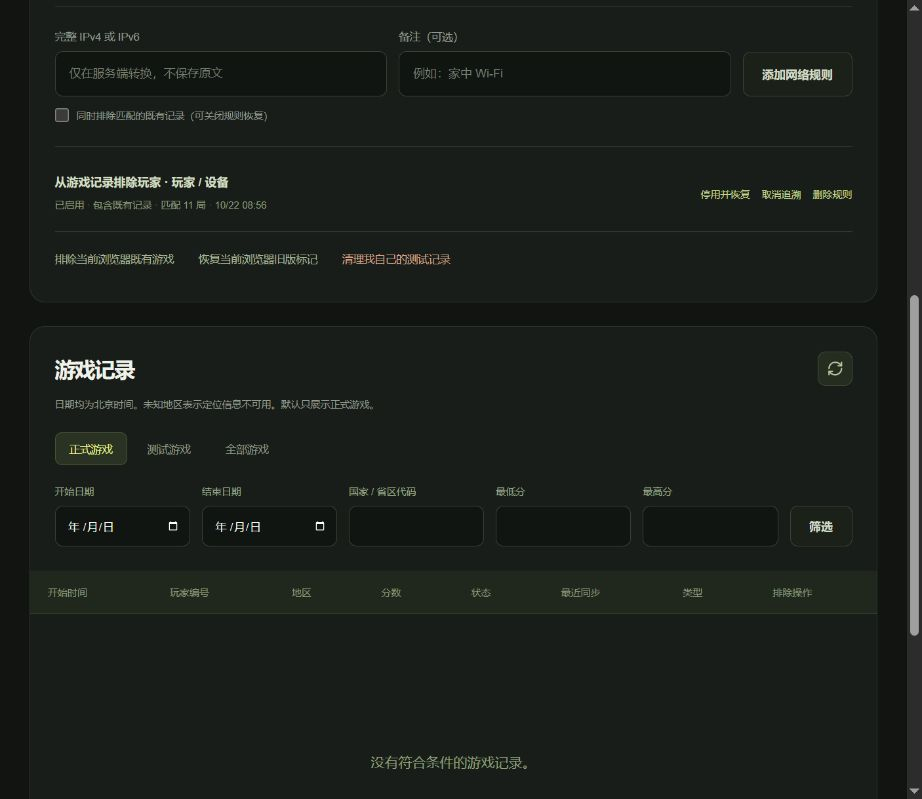

# 瓜瓜物语 / KONG LAB 管理员使用说明

正式网站：https://kong-lab.vercel.app ，管理员入口：https://kong-lab.vercel.app/admin 。

本说明面向站长。以下“正式网址”指 Vercel 项目 kong-lab 的 Domains 页面显示的网址，切勿操作旧项目 xiaomin。菜单可能显示英文，括号内是对应名称。

## 1. 登录后台
在正式网址后加 `/admin`，输入你在 Vercel 设置的 `ADMIN_PASSWORD` 的 **Value（值）**。Key（名称）固定是 ADMIN_PASSWORD；Note（备注）不是密码，也不要往备注粘贴密码或密钥。该密码由你自己设置。不要把密码发到 GitHub 或写进代码。登录有效期 12 小时；退出后测试名单仍然保留。

## 2. 查看今天进入游戏的玩家
后台概览显示“今日正式游戏”和“今日新增玩家”。游戏记录默认是“正式游戏”；把开始日期、结束日期都选为今天，再点“筛选”。日期按北京时间计算，今天第一次出现的玩家计入今日新增玩家。重复玩多局仍是同一玩家。

## 3. 查看分数和时间
每行显示开始时间、玩家编号、地区、分数、是否结束及最近同步时间。开始游戏就有一条 0 分记录，无需等失败。未结束可能是正在玩或直接关掉了页面。分数每几秒同步，网络中断时可能暂时落后；客户端恢复网络会重试。国家、省区无法取得时显示未知，不代表故障。

## 4. 识别自己的测试记录
在你常用的测试浏览器登录后台，名单区域显示当前玩家编号，例如 IP-001。切换“全部游戏”或“测试游戏”，查看该编号。编号只代表匿名浏览器，不是实际 IP；清除 Cookie 或换浏览器可能得到新编号。

## 5. 排除当前设备
点“将当前设备加入测试名单”。之后这个浏览器的新游戏仍然保存，但不会进入正式排行榜和正式概览。想恢复后续统计，点“取消当前设备免统计”。电脑和手机、不同浏览器要分别操作。测试名单不会授予管理员权限，管理员仍需密码。

## 6. 排除当前公网 IP
在正式网站后台点“将当前公网 IP 加入统计排除名单”，阅读共享网络提示后确认。服务器读取本次请求的公网 IP，只保存经过 HMAC 转换的匿名标识。也可在“完整 IPv4 或 IPv6”输入已知地址，填写“家中 Wi-Fi”等备注后添加；不支持网段。原始 IP 不存入数据库，不要把它写进备注。规则列表展示备注、启停状态和匹配局数，不展示完整 IP 或哈希。

## 7. 排除已经存在的测试记录
找到自己的记录，点“排除该玩家”或“排除该网络”，确认后会包含既有和后续匹配记录。网络排除可能影响共用 Wi-Fi 的其他人，优先使用玩家规则。现有规则也可点“包含旧记录”。“排除当前浏览器既有游戏”用于旧版手动标记；此操作只影响当前浏览器。

## 8. 恢复误排除的数据
找到相应规则，点“停用并恢复”，或取消“包含旧记录”；也可删除规则。分数和游戏记录不会因此删除。若同一条游戏同时匹配设备、网络等多个规则，必须逐一解除才会恢复。旧版手动测试标记用“恢复当前浏览器旧版标记”恢复。先使用这些可逆操作；“清理我自己的测试记录”会永久删除当前浏览器已排除的记录，无法恢复，不会批量删除其他浏览器的记录。

## 9. 家庭宽带换了 IP
设备规则不依赖网络，优先使用设备排除。若依赖网络规则，换 IP 后重新在家中 Wi-Fi 下打开后台并添加当前网络，给规则写清备注，再停用不再需要的旧网络规则。运营商可能重新分配旧地址给别人，旧规则不宜长期闲置。

## 10. 5G 和家用 Wi-Fi
从 Wi-Fi 切换到 5G 会改变公网出口，5G 还可能多人共享地址。不要把网络出口当成个人身份。相同浏览器通常恢复原编号；无痕模式、不同手机或清除 Cookie 会产生新编号。为了只排除自己，请在每个测试浏览器添加设备规则，谨慎使用 5G 网络规则。

## 11. 更换管理员密码
打开 Vercel → kong-lab → Settings（设置）→ Environment Variables（环境变量），找到 `ADMIN_PASSWORD`，编辑为新密码并保存。对需要的 Production（生产）环境生效，然后去 Deployments（部署）点 Redeploy（重新部署）。新部署就绪后用新密码登录。修改管理员密码并部署后，旧管理员登录会立即失效。仅当需要使全部玩家、游戏和管理员签名凭据失效时才更换 `SESSION_SECRET`；这也会让旧匿名玩家 Cookie 和未上传的局次令牌失效。不要修改 `IP_HMAC_SECRET`，否则旧网络排除规则无法匹配新记录。

## 12. 查看 Neon 免费额度
打开 Vercel 的 kong-lab → Storage（存储）→ Neon 数据库 → Open in Neon（打开 Neon）。查看 Usage（用量）和 Plan（套餐）。确认仍为 Free / $0；查看存储、计算时间、流量及配额重置时间。实际额度以页面为准。免费额度耗尽可能暂停服务；不要点 Upgrade（升级）、不要绑卡。先减少测试写入、清理限流过期记录或等待额度重置；删除数据前先备份。

## 13. 确认 Vercel 部署最新代码
打开 GitHub 的 kong-lab，记下 main 分支最新提交的短编号。到 Vercel → kong-lab → Deployments，找到同一提交，确认状态 Ready（就绪）并标记 Production（生产）。点 Visit（访问），再访问正式域名查看本次修改。Building（构建中）或 Error（失败）不能算上线。生产域名与某次预览地址可能不同。

## 14. 以后更新网站
将修改提交到仓库 kong-lab 的 main 分支，Vercel 会自动构建。涉及数据库结构的修改要先核对迁移说明并备份；普通文字、样式、图片无需重新建数据库。等待部署 Ready 后检查正式域名。若手机仍显示旧界面，先退出页面重新打开或强制刷新。不要把环境变量、连接字符串、密码上传到 GitHub，不要修改 xiaomin 仓库。

## 15. 回滚到正常版本
到 Vercel → kong-lab → Deployments，找到之前已验证的 Ready 部署，打开菜单选择 Promote to Production（提升为生产）或 Instant Rollback（即时回滚，以界面显示为准），核对项目名和目标版本后确认。回滚只切换网站代码，不自动撤销数据库变更。若下一次 main 推送又触发新部署，仍会替换生产版本；需要长期恢复时请在 GitHub 提交一个撤销问题修改的新提交。不要删除旧部署或数据库来代替回滚。

## 常见现象
- 排行榜没出现自己的成绩：检查是否在测试名单、是否已同步、榜单日期和当前浏览器编号。
- 正式玩家数比游戏数少：同一玩家可以玩多局；测试记录不计入正式人数。
- 断网还能玩：已有游戏不受上传失败影响；重连后自动重试。首次连不上可明确选择离线游玩，离线成绩不上传。
- 排行榜打开后游戏停住：这是保护操作，关闭后返回同一局；若你原本已暂停或切换过后台，需主动点继续。
- 管理员页面打不开或出现数据库错误：检查 Vercel 部署日志、Neon Free 用量和数据库连接状态，勿在公共群聊贴出密钥。

## 本次上线后的初始状态

验收浏览器为 IP-001，已添加包含既有记录的玩家测试规则。11 局验收游戏保留在“测试游戏”中，其中真实最高分为 1；正式概览与排行榜均不计入这些记录。两个临时网络规则已移除，没有永久排除整个共享网络。你自己的手机、另一个浏览器会按自己的匿名身份正常统计；如果用于测试，请分别加入设备名单。

